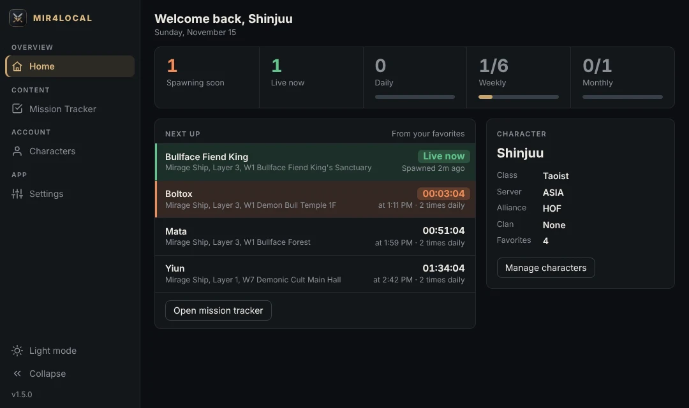
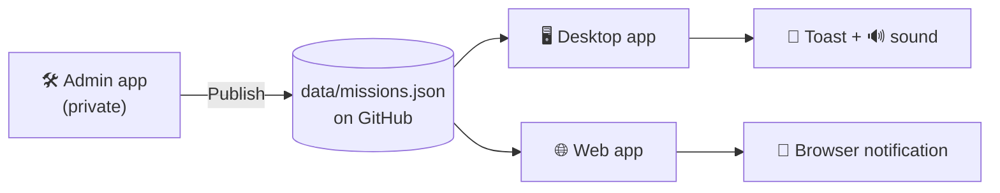

<div align="center">


<br>

[](https://github.com/fsocietyshinjuu/Mir4-Local/releases/latest)
[](https://github.com/fsocietyshinjuu/Mir4-Local/releases)
[](https://fsocietyshinjuu.github.io/Mir4-Local/app/)
[](#-languages)

**[Download](#-download)** · **[Web app](https://fsocietyshinjuu.github.io/Mir4-Local/app/)** · **[Features](#-features)** · **[How it works](#-how-it-works)** · **[FAQ](#-faq)** · **[Release notes](RELEASE_NOTES.md)** · **[Changelog](CHANGELOG.md)**

</div>

<br>

<p align="center">
  <picture>
    <source media="(prefers-color-scheme: dark)" srcset="docs/assets/shot-dark.webp">
    <source media="(prefers-color-scheme: light)" srcset="docs/assets/shot-light.webp">
    
  </picture>
</p>

> [!NOTE]
> Mir4Local is an unofficial fan-made tool. It is not affiliated with Wemade or the makers of MIR4. MIR4 and related names are trademarks of their owners.

## ✨ Features

| | |
|---|---|
| ⏱️ **Live countdowns** | See exactly when each boss spawns next, in your own time zone. |
| 🟠🟢 **Spawning and spawned highlights** | Bosses about to spawn glow orange, bosses that just spawned glow green. |
| 🔔 **Toasts and sounds** | A small card in the corner (never stealing focus) plus a chime before, at, and after a spawn. |
| 🏠 **Home dashboard** | What is spawning soon, what is live, upcoming world bosses and events, and your daily, weekly and monthly progress. |
| 🐉 **World Boss** | Weekly world boss schedules with boss, map, area, location and spawn times. |
| 🎪 **Events** | Event schedules with multiple maps, areas and locations. |
| 🛠️ **Crafting** | Summon badges with admin-uploaded images, crafting NPCs and summon locations. |
| 📜 **Mystery** | Mystery scroll lists and tutorial links, one entry per mystery. |
| 🧑‍🤝‍🧑 **A list per character** | Separate favorites and progress for every character, with IGN, class, server, alliance and clan. |
| 🎲 **Random and respawn bosses** | Bosses without fixed times are labelled "Random spawn" or "Respawns after kill". |
| 🌍 **12 languages** | Full UI translations, plus published boss, mission, map, area and location names. |
| 🌗 **Light and dark** | Follows your system or your choice. |
| 🪟 **Tray mode** | Close the window and keep reminders running from the system tray. |
| 🔄 **Always current** | Data refreshes with ETag checks and retries, then falls back to cached or bundled data when offline. |
| 🛟 **Safer reminders** | Deduplicated across restarts and recalculated when you return to the tab. |
| 🧪 **Validated data** | Bad published records are skipped or repaired instead of breaking a whole tab. |

<details>
<summary><b>🖼️ More screenshots</b></summary>
<br>

<p align="center">
  <picture>
    <source media="(prefers-color-scheme: dark)" srcset="docs/assets/home-dark.webp">
    <source media="(prefers-color-scheme: light)" srcset="docs/assets/home-light.webp">
    
  </picture>
</p>

</details>

## 📥 Download

| Platform | Get it |
|---|---|
| 🪟 **Windows** | [Download the installer (.exe)](https://github.com/fsocietyshinjuu/Mir4-Local/releases/latest) |
| 🍎 **macOS** | [Download the .dmg](https://github.com/fsocietyshinjuu/Mir4-Local/releases/latest) |
| 🐧 **Linux** | [Download the AppImage](https://github.com/fsocietyshinjuu/Mir4-Local/releases/latest) |
| 🌐 **Browser** | [Open the web app](https://fsocietyshinjuu.github.io/Mir4-Local/app/) |

<details>
<summary><b>Which one should I pick?</b></summary>
<br>

- **Desktop app:** the most reliable reminders. It runs in the background, can live in the tray, and updates itself.
- **Web app:** nothing to install. Keep the tab open to get reminders. Browsers can slow down background tabs, so reminders may be a little late.

On Windows, SmartScreen may warn about an unsigned app the first time. Choose **More info → Run anyway**.

</details>

## 🧭 How it works



The admin app is a private tool that edits `data/missions.json` in this repository. The desktop and web apps read that file, so new content reaches everyone without a new release.

<details>
<summary><b>📄 Data format</b></summary>
<br>

```jsonc
{
  "version": 1,
  "updatedAt": "2026-11-26T16:17:42.338Z",
  "utcOffset": 480,                  // time zone of the spawn times, in minutes from UTC
  "timeLabel": "UTC+8",
  "missions": [
    {
      "id": "k3j2h1",
      "name": "Mata",
      "map": "Mirage Ship",
      "area": "Layer 3",
      "location": "[World 1] Bullface Forest",
      "type": "Spawn",               // "Spawn" or "Summon"
      "cycle": "Weekly",             // "Daily", "Weekly" or "Monthly" (when your checkbox resets)
      "spawnMode": "scheduled",      // "scheduled" (default), "random" or "respawn"
      "spawnTimes": ["00:00", "02:00", "04:00"],   // scheduled only, repeats every day
      "respawnMinutes": 150,         // respawn only, optional
      "i18n": {                      // optional per-language text, keyed by field
        "name": { "ko": "마타" },
        "map": { "ko": "미라지 쉽" },
        "area": { "ko": "3층" },
        "location": { "ko": "불얼굴 숲" }
      }
    }
  ],
  "worldBosses": [
    {
      "id": "wb1", "name": "Krukan", "map": "Bicheon", "area": "Bicheon Valley",
      "location": "Shackling Abaddon",
      "schedule": [{ "days": [1], "times": ["23:00"] }],
      "i18n": { "name": { "ko": "크루칸" } }
    }
  ],
  "events": [
    {
      "id": "ev1", "name": "Magic Square", "map": "Mirage Ship",
      "areas": [
        { "map": "Mirage Ship", "area": "Fissure", "location": "Magic Square",
          "schedule": [{ "days": ["*"], "times": ["00:00", "03:00"] }] }
      ]
    }
  ],
  "crafting": [
    { "id": "cr1", "boss": "Mata", "badge": "Mata Badge",
      "badgeImage": "https://raw.githubusercontent.com/fsocietyshinjuu/Mir4-Local/main/data/assets/badges/cr1.webp",
      "npc": "Blacksmith", "npcLocation": "Layer 1", "summonLocation": "Bullface Forest" }
  ],
  "mystery": [
    { "id": "my1", "name": "Ancient Mystery", "scrolls": ["Scroll of Fire"], "tutorial": "https://…" }
  ]
}
```

`days` are `0`–`6` (Sunday–Saturday) or `"*"` for every day; `24:00` means midnight at the end of that day. Events can have several areas, each with its own schedule. Missions saved before `spawnMode` existed keep working: they are treated as `scheduled`.

Badge images are uploaded in **Admin → Crafting**, never pasted as URLs. The admin resizes each image to at most 256×256 WebP, publishes it to `data/assets/badges/`, and stores the returned URL in `badgeImage`. Replacing or removing an image deletes the old asset. The Publish tab previews changes, validates the data and keeps the last 10 published versions available for one-click rollback.

</details>

## 🌍 Languages

<details>
<summary><b>Show all 12</b></summary>
<br>

English · 한국어 · 日本語 · 简体中文 · 繁體中文 · ไทย · Bahasa Indonesia · Tiếng Việt · Deutsch · Español · Português · Русский

Pick yours in **Settings → Language**. The first launch follows your system language. The UI and the published boss, mission, map, area and location names are translated in all 12 languages.

**Why are translations stored in the data instead of translated live in the browser?**

- The free translation endpoint used by the admin tool sends no `Access-Control-Allow-Origin` header, so a browser page on `github.io` is blocked from reading the response by CORS. The admin app is a desktop app and can call it without that restriction.
- Translating every field for every user on every load would mean thousands of requests per page view. The endpoint rate-limits hard (HTTP 429), so live translation would be slow and unreliable.
- Storing translations once at publish time makes the app load instantly, work offline, and show the same text to everyone.

Admin → **Auto-translate missing** fills in any missing fields before publishing. You can edit each translation by hand in the drawer if you want different wording.

</details>

## 🔔 Reminders

<details>
<summary><b>How reminders work</b></summary>
<br>

Turn reminders on in **Settings → Reminders**.

- **When:** 5 minutes before a spawn, at the spawn, and 5 minutes after. Choose any combination.
- **For which bosses:** your active character's favorites, or all bosses with a spawn time. Missions you have marked complete are skipped.
- **How:** a toast in the top-right corner of your screen (a browser notification on the web), plus an optional chime. If notifications are blocked, you get an in-app toast instead.
- **Keep it running:** the app has to be open. It can stay minimized, or live in the tray when you close the window.

Toasts do not appear over games running in exclusive fullscreen. Use windowed or borderless fullscreen.

</details>

## 🛠️ Build from source

```bash
git clone https://github.com/fsocietyshinjuu/Mir4-Local.git
cd Mir4-Local
npm install
npm start            # run the desktop app
npm run dist         # build an installer into dist/
```

<details>
<summary><b>Admin app and project layout</b></summary>
<br>

```bash
cd admin
npm install
npm start            # the private admin tool (needs a GitHub token to publish)
```

```
├── main.js, preload.js        desktop shell: window, tray, toasts, updates
├── renderer/                  the app (desktop and web share these files)
│   ├── toast/                 the top-right toast window
│   ├── i18n.js                translations for 12 languages
│   ├── fallback-data.js       bundled offline snapshot
│   └── platform.js            lets the same code run in a browser
├── admin/                     private admin app (not part of the public installer)
├── docs/                      landing page for GitHub Pages
├── data/missions.json         the published content
└── .github/workflows/         release build and website deploy
```

Releases are built by GitHub Actions when you push a tag such as `v1.1.0`. The tag must match the `version` in `package.json`. Landing page changes deploy on a push to `main` that touches `docs/**`, `renderer/**` or the Pages workflow.

</details>

## ❓ FAQ

<details>
<summary><b>I published new data but the web app still looks old.</b></summary>
<br>

GitHub's raw content and the Pages CDN cache responses for about **5 minutes**. The app also checks for updates with an ETag and refreshes automatically every 15 minutes. Click **Refresh** in Settings to force a fresh check, or hard-reload the tab (`Ctrl+Shift+R` / `Cmd+Shift+R`). A short wait is normal.

</details>

<details>
<summary><b>Why does the app say a release isn't ready?</b></summary>
<br>

A release is visible a few minutes before its installer files finish uploading. Try again shortly.

</details>

<details>
<summary><b>I don't see toasts or hear sounds.</b></summary>
<br>

Check that **Desktop notifications** or **Sound reminder** is switched on, that **Remind me** has at least one option ticked, and that the boss is one of your favorites (or switch **Which bosses** to all). Use **Send test** to check the toast. The app must be running.

</details>

<details>
<summary><b>What are "Random spawn" and "Respawns after kill"?</b></summary>
<br>

Some bosses have no fixed time. "Random spawn" means it appears unpredictably. "Respawns after kill" means it comes back some time after being killed (the typical time is shown when known). These have no countdown and no reminders.

</details>

<details>
<summary><b>Does it work offline?</b></summary>
<br>

The last mission data is saved on your computer, and the app ships with a bundled fallback snapshot, so the list still shows. New content needs a connection.

</details>

<details>
<summary><b>Where is my data stored?</b></summary>
<br>

Favorites, characters and progress stay on your own computer (or browser). Nothing you enter is sent anywhere. The app only downloads the published mission data.

</details>

## 👤 Developer

**Shinjuu** · [fsociety.shinjuu@gmail.com](mailto:fsociety.shinjuu@gmail.com)

Bug reports and ideas are welcome. Please [open an issue](https://github.com/fsocietyshinjuu/Mir4-Local/issues) or send an email.
