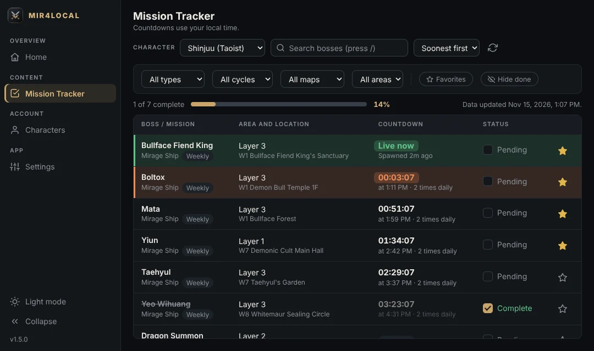
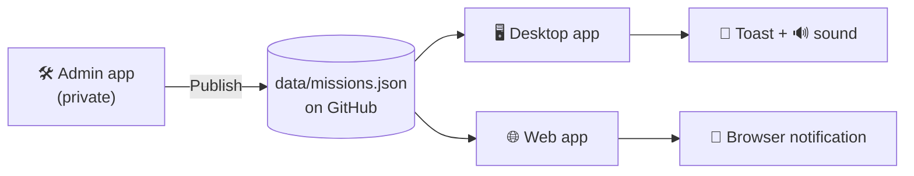

<div align="center">



<br>

[](https://github.com/fsocietyshinjuu/Mir4-Local/releases/latest)
[](https://github.com/fsocietyshinjuu/Mir4-Local/releases)
[](https://fsocietyshinjuu.github.io/Mir4-Local/app/)
[](#-languages)

**[Download](#-download)** · **[Web app](https://fsocietyshinjuu.github.io/Mir4-Local/app/)** · **[Features](#-features)** · **[How it works](#-how-it-works)** · **[FAQ](#-faq)** · **[Release notes](RELEASE_NOTES.md)**

</div>

<br>

<p align="center">
  <picture>
    <source media="(prefers-color-scheme: dark)" srcset="docs/assets/shot-dark.webp">
    <source media="(prefers-color-scheme: light)" srcset="docs/assets/shot-light.webp">
    
  </picture>
</p>

> [!NOTE]
> Mir4Local is an unofficial fan-made tool. It is not affiliated with Wemade or the makers of MIR4. MIR4 and related names are trademarks of their owners.

## ✨ Features

| | |
|---|---|
| ⏱️ **Live countdowns** | See exactly when each boss spawns next, in your own time zone. |
| 🟠🟢 **Spawning and spawned highlights** | Bosses about to spawn glow orange, bosses that just spawned glow green. |
| 🔔 **Top-right toast pop-ups** | A small card in the corner of your screen, never stealing focus from the game. |
| 🔊 **Sound reminders** | A short chime 5 minutes before, at, and 5 minutes after a spawn. |
| 🏠 **Home dashboard** | What is spawning soon, what is live, and your daily, weekly and monthly progress at a glance. |
| 🧑‍🤝‍🧑 **A list per character** | Separate favorites and progress for every character, with IGN, class, server, alliance and clan. |
| 🎲 **Random and respawn bosses** | Bosses without fixed times are labelled "Random spawn" or "Respawns after kill". |
| 🌍 **12 languages** | The languages MIR4 supports. |
| 🌗 **Light and dark** | Follows your system or your choice. |
| 🪟 **Tray mode** | Close the window and keep reminders running from the system tray. |
| 🔄 **Always current** | Mission data updates online and the desktop app updates itself. |

<details>
<summary><b>🖼️ More screenshots</b></summary>
<br>

<p align="center">
  <picture>
    <source media="(prefers-color-scheme: dark)" srcset="docs/assets/home-dark.webp">
    <source media="(prefers-color-scheme: light)" srcset="docs/assets/home-light.webp">
    
  </picture>
</p>

</details>

## 📥 Download

| Platform | Get it |
|---|---|
| 🪟 **Windows** | [Download the installer (.exe)](https://github.com/fsocietyshinjuu/Mir4-Local/releases/latest) |
| 🍎 **macOS** | [Download the .dmg](https://github.com/fsocietyshinjuu/Mir4-Local/releases/latest) |
| 🐧 **Linux** | [Download the AppImage](https://github.com/fsocietyshinjuu/Mir4-Local/releases/latest) |
| 🌐 **Browser** | [Open the web app](https://fsocietyshinjuu.github.io/Mir4-Local/app/) |

<details>
<summary><b>Which one should I pick?</b></summary>
<br>

- **Desktop app:** the most reliable reminders. It runs in the background, can live in the tray, and updates itself.
- **Web app:** nothing to install. Keep the tab open to get reminders. Browsers can slow down background tabs, so reminders may be a little late.

On Windows, SmartScreen may warn about an unsigned app the first time. Choose **More info → Run anyway**.

</details>

## 🧭 How it works



The admin app is a private tool that edits `data/missions.json` in this repository. The desktop and web apps read that file, so new content reaches everyone without a new release.

<details>
<summary><b>📄 Data format</b></summary>
<br>

```jsonc
{
  "version": 1,
  "updatedAt": "2026-11-15T08:00:00.000Z",
  "utcOffset": 480,                  // time zone of the spawn times, in minutes from UTC
  "missions": [
    {
      "id": "k3j2h1",
      "name": "Mata",
      "map": "Mirage Ship",
      "area": "Layer 3",
      "location": "W1 Bullface Forest",
      "type": "Spawn",               // "Spawn" or "Summon"
      "cycle": "Weekly",             // "Daily", "Weekly" or "Monthly" (when your checkbox resets)
      "spawnMode": "scheduled",      // "scheduled" (default), "random" or "respawn"
      "spawnTimes": ["00:00", "02:00", "04:00"],   // scheduled only, repeats every day
      "respawnMinutes": 150          // respawn only, optional
    }
  ]
}
```

Missions saved before `spawnMode` existed keep working: they are treated as `scheduled`.

</details>

## 🌍 Languages

<details>
<summary><b>Show all 12</b></summary>
<br>

English · 한국어 · 日本語 · 简体中文 · 繁體中文 · ไทย · Bahasa Indonesia · Tiếng Việt · Deutsch · Español · Português · Русский

Pick yours in **Settings → Language**. The first launch follows your system language. Boss and area names come from the published data and are not translated.

</details>

## 🔔 Reminders

<details>
<summary><b>How reminders work</b></summary>
<br>

Turn reminders on in **Settings → Reminders**.

- **When:** 5 minutes before a spawn, at the spawn, and 5 minutes after. Choose any combination.
- **For which bosses:** your active character's favorites, or all bosses with a spawn time. Missions you have marked complete are skipped.
- **How:** a toast in the top-right corner of your screen (a browser notification on the web), plus an optional chime.
- **Keep it running:** the app has to be open. It can stay minimized, or live in the tray when you close the window.

Toasts do not appear over games running in exclusive fullscreen. Use windowed or borderless fullscreen.

</details>

## 🛠️ Build from source

```bash
git clone https://github.com/fsocietyshinjuu/Mir4-Local.git
cd Mir4-Local
npm install
npm start            # run the desktop app
npm run dist         # build an installer into dist/
```

<details>
<summary><b>Admin app and project layout</b></summary>
<br>

```bash
cd admin
npm install
npm start            # the private admin tool (needs a GitHub token to publish)
```

```
├── main.js, preload.js        desktop shell: window, tray, toasts, updates
├── renderer/                  the app (desktop and web share these files)
│   ├── toast/                 the top-right toast window
│   ├── i18n.js                translations for 12 languages
│   └── platform.js            lets the same code run in a browser
├── admin/                     private admin app (not part of the public installer)
├── docs/                      landing page for GitHub Pages
├── data/missions.json         the published content
└── .github/workflows/         release build and website deploy
```

Releases are built by GitHub Actions when you push a tag such as `v1.0.0`. The tag must match the `version` in `package.json`.

</details>

## ❓ FAQ

<details>
<summary><b>Why does the app say a release isn't ready?</b></summary>
<br>

A release is visible a few minutes before its installer files finish uploading. Try again shortly.

</details>

<details>
<summary><b>I don't see toasts or hear sounds.</b></summary>
<br>

Check that **Desktop notifications** or **Sound reminder** is switched on, that **Remind me** has at least one option ticked, and that the boss is one of your favorites (or switch **Which bosses** to all). Use **Send test** to check the toast. The app must be running.

</details>

<details>
<summary><b>What are "Random spawn" and "Respawns after kill"?</b></summary>
<br>

Some bosses have no fixed time. "Random spawn" means it appears unpredictably. "Respawns after kill" means it comes back some time after being killed (the typical time is shown when known). These have no countdown and no reminders.

</details>

<details>
<summary><b>Does it work offline?</b></summary>
<br>

The last mission data is saved on your computer, so the list still shows. New content needs a connection.

</details>

<details>
<summary><b>Where is my data stored?</b></summary>
<br>

Favorites, characters and progress stay on your own computer (or browser). Nothing you enter is sent anywhere. The app only downloads the published mission data.

</details>

## 👤 Developer

**Shinjuu** · [fsociety.shinjuu@gmail.com](mailto:fsociety.shinjuu@gmail.com)

Bug reports and ideas are welcome. Please [open an issue](https://github.com/fsocietyshinjuu/Mir4-Local/issues) or send an email.
